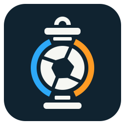
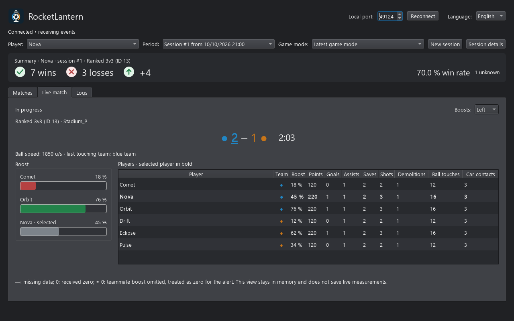

# RocketLantern

[English](README.md) | [Français](README.fr.md)

<p align="center">
  
</p>

RocketLantern is a desktop companion for Rocket League. Keep track of your
evening's wins and losses, look back at your matches, or watch your
teammates' boost on a second screen while you play.

Available for Windows, in French and English.

## Download and install

**[Download the latest stable Windows release][latest-release]**

Use the Windows installer; you don't need Python or any developer tools.

1. Open the release page and expand **Assets**.
2. Download `RocketLantern-<version>-windows-x64-setup.exe`.
3. Run the installer, then launch **RocketLantern** from the Start menu.

The installer is for Windows x64 and doesn't need administrator rights.
The app is not code-signed yet, so Windows may show a SmartScreen warning.

Prefer not to install? Download
`RocketLantern-<version>-windows-x64-portable.zip`, extract the **entire**
archive, then run `RocketLantern.exe` from the extracted folder.



Preview with fictional players and match data.

## Enable Rocket League's Stats API

RocketLantern reads the game's built-in Stats API. You'll need to enable
it once before your first match; no BakkesMod plugin is required.

On first launch, a setup guide walks you through these settings. You can
skip it and reopen it from **Settings → Setup guide**.

1. Close Rocket League.
2. In RocketLantern's setup guide or **Settings**, click **Check
   configurations** to find your Steam and Epic Games installations. We
   recommend leaving **Desired rate (PacketSendRate)** at **10 packets/s**.
   Use **Apply** next to an installation to change its rate.
3. Click **Open folder** to open its `TAGame\Config` folder. Check `WebPort`
   in `TAStatsAPI.ini`, or `DefaultStatsAPI.ini` if the first file is absent.

A typical configuration looks like this. Edit the existing section rather
than adding a second copy:

```ini
[TAGame.MatchStatsExporter_TA]
PacketSendRate=10
WebPort=49124
```

Start Rocket League again after saving any changes.

RocketLantern connects to `127.0.0.1` on port `49124` by default. If you use
a different `WebPort`, open **Settings**, set the same **Local port** and click
**Reconnect**. The TCP `Port`, if enabled, must differ from `WebPort`.

The app changes only `PacketSendRate`; you still need to check `WebPort`
yourself. It writes the file only when you click **Apply**, keeps the other
settings and saves a backup. A rate below your target means less frequent
live updates. A higher rate is fine and doesn't need reducing.

If your installation is not detected, locate its `TAGame\Config` folder
manually and edit the same settings. If the game still isn't sending data,
check the user configuration mentioned in [Troubleshooting](#troubleshooting).

See the [official Stats API documentation][stats-api] for more details.

## Using RocketLantern

1. Open RocketLantern and start a Rocket League match.
2. Select your player in the **Player** list. Your selection is remembered.
3. Keep the application open until the match result arrives.

On Windows, RocketLantern waits for the game before connecting. Switching
to another application does not interrupt match tracking.

Tracking starts here: the app doesn't import your past account history.

### Sessions and match history

The banner shows your W/L, difference and win rate for the current session
and game mode. Switch from 3v3 to 2v2 and it shows your 2v2 results; switch
back and your 3v3 results are still there. Use the filters to see all modes,
an earlier session or your full history.

A new session starts automatically after a gap of at least one hour between
results. **New session** starts one immediately without deleting history.

In **Matches**, you'll find your history, totals and per-match averages for
score, goals, assists, saves, shots, demolitions and touches. Click a match
for its players and events, or **Session details** for the whole session.
Missing values appear as “—”; a match joined late can have partial data.

If you leave or lose connection before a confirmed result arrives, the
match is marked **unknown**, not a loss, and excluded from the win rate.
Historical replays don't count towards your results.

### Live match and teammates' boost

Keep **Live match** open on a second screen for the score, clock, player
stats and boost gauges. Your team's score is underlined, and you can put
the gauges on either side with **Boosts: Left / Right**.

Teammate gauges turn from green to orange to red as boost runs low, with an
animated alert when empty. Your selected player's gauge stays gray.
“≈ 0 %” is an alert for a missing boost value, not a confirmed zero.
Boost and speed are live displays, not saved timelines.

### Manual match assessment

Click the tag after the W/L delta to mark a match as **Not evaluated**, **No
suspicion**, **Possible smurf**, or **Strong suspicion**. You can change it
during the game or later using its tag in history. Each choice has its own
symbol and a label on hover. These are personal notes about suspected
smurfing, not automatic detections or reports to Epic.

To rate a match without leaving the game, enable **global keyboard
shortcuts** in **Settings**, then click **Apply shortcuts**. They are off by
default; **Ctrl+Shift+F1** through **F4** select the four choices above.
See the [user guide](docs/user-guide.md#manual-match-assessment) for the
shortcut settings and how the current/last match is selected.

## Settings and updates

Open **Settings** from the main toolbar to change the language or choose
whether **Matches** or **Live match** opens at startup. The language changes
immediately, and your preferences are remembered next time.

Updates default to **Stable updates**. You can turn checks off with
**Disabled**, or try development builds with **All updates (unstable)**;
those may contain bugs. Checks run at startup and every ten minutes while
enabled. **Check now** lets you check manually.

When a newer version is available, a download icon appears beside the app
name: green for stable, orange for a preview. Clicking it asks for
confirmation before downloading or opening a browser. The installed app
can download a verified installer and launch the setup wizard for you.
RocketLantern closes to allow the update. Otherwise, including with a
portable version, it opens the release page so you can update manually.
Your history is kept.

## Local data and privacy

History, match statistics, assessments and preferences are saved locally in:

```text
%LOCALAPPDATA%\RocketLantern\RocketLantern\matches.sqlite3
```

This includes player names and IDs. Updates and uninstallation don't remove
the database, and you don't need an extra account. Update checks contact
GitHub but don't send player or match data; choose **Disabled** in Settings
to stop those requests.

## Troubleshooting

**Connected, but no matches or events?**

- Check reception during a match: silence in the game menus can be normal.
- Check that the game's `WebPort` matches RocketLantern's **Local port**.
- Fully restart Rocket League after editing its configuration.
- If present, also check the user configuration at
  `Documents\My Games\Rocket League\TAGame\Config\TAStatsAPI.ini`.
- Open **Logs** for connection errors and received events. Logs stay in
  memory; player names and IDs are redacted.

For additional diagnostics, see the
[user guide](docs/user-guide.md#diagnostics-logs-tab).

## More information

- [Releases and downloads][releases]
- [Detailed user guide](docs/user-guide.md)
- [Boost overlay: sources and project position](docs/boost-overlay-fair-play.md)
- [Development, Windows builds and release publishing](docs/development.md)

[latest-release]: https://github.com/akerfourn/rocket-lantern/releases/latest
[releases]: https://github.com/akerfourn/rocket-lantern/releases
[stats-api]: https://www.rocketleague.com/developer/stats-api?lang=en
