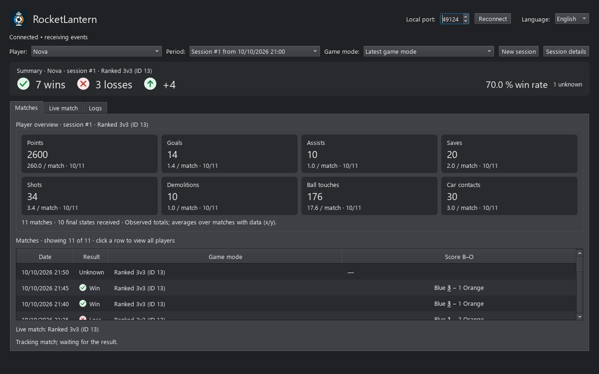

# Detailed user guide

For downloads, installation and initial game configuration, see the
[README](../README.md).

Preview with fictional players and match data.

## Usage

1. Start the application, then a Rocket League match.
2. Select your player in the list; their ID is remembered.
3. Keep the application open until the match result arrives.

Choose **Français** or **English** next to the local port. The preference
is saved locally. Labels, filters, tooltips and open detail windows update
immediately without restarting the application or reconnecting to the game.
Dates and decimal separators follow the selected language. Player names,
IDs, arena names and API data are not translated. Existing log entries keep
the language used when they were recorded.
On first launch, the system language selects French or English.

Wins, losses, their difference, win rate and unknown results appear above
the tabs. A check and a cross distinguish outcomes without relying solely
on color. The summary and selectors remain visible in **Matches**,
**Live match** and **Logs**.

Selectors filter the summary, player statistics and the last 100 displayed
observations. Totals and averages cover all matches matching the filter,
including those beyond these 100 rows.
Defaults are the current session and latest game mode. The latest mode
automatically follows the playlist announced by the game; returning to a
mode restores its results within the session. **All game modes** combines
playlists. The period can also select an older session or the full history.
Selecting a session updates the overview without opening a window.
**Session details** opens the entire session across all playlists: totals
and averages, dates, outcomes, arenas, scores, overtime and the selected
player's statistics for each match. Clicking a match opens its participants
and events. Detail windows show the data saved when they were opened.

The overview displays points, goals, assists, saves, shots, demolitions,
ball touches and car contacts. Each card shows the total, average per match
and number of matches with data out of the filtered matches (`x/y`).
Missing values appear as “—”; received zeros remain “0”. Averages exclude
only missing values, not zeros. Partial data and unknown results contribute
to statistics; the number of received final states is shown.

A new session starts after a gap of at least one hour between results.
Every session has a database ID per player, independent of playlists.
**New session** immediately creates an empty session and resets its counters
without deleting history. The next unsaved result joins it, even if the
match is already in progress. A late correction stays in the match's
original session. Sessions, including empty ones, survive restarts.
After one hour without a result, or since an empty session was created,
the current session is empty until the next result creates a new session.
When first launching this version, older data is migrated automatically:
initial grouping using the one-hour rule, then permanent ID assignment.
These groups are no longer recalculated.

Unknown results are excluded from the win rate. Game modes appear live and
in history, such as `Ranked 2v2`, `Casual 3v3` and `Private match`. API IDs
remain visible; unlisted IDs are shown as unknown. Dates refer to when the
result was observed and are displayed in local time.

### Live match

This tab displays the last received score, clock, overtime, game mode,
arena, ball speed in Unreal units/second, last touching team and counters
for present participants. The selected player's team score is underlined.
History filters do not affect this view of the observed match.

A gauge shows the selected player's boost, and a named gauge appears for
each present teammate, identified by ID and team. Changing the selected
player changes the displayed team. Gauges form a compact 240-pixel column
with names above the bars. **Boosts: Left / Right** is saved locally.
At a tab width of 900 pixels or more, the column sits beside the table;
otherwise, it remains above the table, aligned to the chosen side.
Team names in the score and table are replaced with blue and orange dots
with tooltips. The selected player's team score remains underlined.

Teammate gauges are green above 50 %, orange above 25 %, and red at or
below 25 %. At 0 %, the entire red bar shows animated loading-style stripes
with “0 % · empty” beside it. The selected player's boost stays gray,
without a zero-boost alert animation. Animations stop when the view is
hidden. If a present teammate's `Boost` field is omitted, their gauge shows
the same animated red alert as zero, with “≈ 0 %”: this is a display
assumption, not a received value. An invalid value or a player explicitly
without a car remains a disabled “—” gauge. This assumption is not applied
to the selected player. Values and colors update with each received state
without recreating gauges for every packet.

The table also shows received values for other players. The display does
not assume that only the local player is visible. Missing or invalid fields
remain “—” in the table and received state, not zero. An omitted value is
not carried over from an older state; the “≈ 0 %” alert applies only to
teammate gauges. Visibility depends on data emitted by the game.
Boost is not inferred from pickup events.

The view retains only the latest state in memory: no boost or speed time
series is stored in SQLite. Existing match summaries and important event
storage remain unchanged. Disconnecting or leaving the match clears the
values. Goal replays retain the last non-replay data, explicitly labeled;
historical replays are excluded from this live view.

We recommend `PacketSendRate=10` for ten periodic updates per second and
smoother live gauges. With `1`, updates arrive once per second.
Editing the INI requires restarting
the game. See the [official configuration][stats-api]. RocketLantern does
not change the INI.

Preferences and results are stored in `matches.sqlite3` in Qt's local data
directory, retaining the historical `RLWinLoss` name. Renaming the app to
RocketLantern does not move or reset the database. On Windows:
`%LOCALAPPDATA%\RLWinLoss\RLWinLoss\matches.sqlite3`.
Participant names and IDs are stored locally with their match statistics.
No remote service or additional account is used.

### Match details

Click a history row to open the match sheet: blue/orange score, followed
by **Players**, **Events** and **Information** tabs (arena, overtime,
playlist, last observation and IDs).
The table shows all observed players grouped by team. The selected player
is identified by ID, with a highlighted row and a “selected” annotation;
their team's score remains bold and underlined. The Events tab lists goals,
statistics events (`StatfeedEvent`) and crossbar hits.
Each player retains their last received counters: points, goals, shots,
assists, saves, ball touches, car contacts and demolitions. Leaving the
match does not remove their statistics.

Goals retain the scorer, optional assister, team, ball speed and position
when available. Speeds are in Unreal units/s. The clock is the last value
received from the game; `GoalTime` remains separate and represents the
previous round's duration, not the goal's timestamp.
Event identities are linked to participants only when the ID or the
shortcut/team/name combination permits consistent attribution. An
unresolved identity remains missing, never assigned by name alone.

A missing value appears as “—”, distinct from zero. Without a state
received after the winner announcement, the score and statistics remain
the last observed values, potentially partial. Late states enrich an
already saved result without counting the match again. Even with a final
state, events cover only the connection period; departed participants
retain their last observed values. Goal and historical replays must not
add statistics or events.

SQLite stores structured tables with internal IDs, foreign keys and
uniqueness constraints. No raw JSON message or continuous trajectory is
retained. Goals are `GoalScored` events. Identical events in the same clock
context are deduplicated; the API provides no event ID, so two strictly
identical events in that context cannot be distinguished. Migration is
automatic and preserves existing history at the same location. Older
matches do not receive statistics retroactively.

## Diagnostics: Logs tab

Restart the application after a code update, then open **Logs**.
The tab displays the last 1,000 timestamped entries:

- WebSocket address, connection, disconnection and exact socket errors.
- All received events, including `UpdateState`, before processing.
- Invalid JSON messages and match-tracking rejection reasons.
- Saved results, message count and last receive time.

Logs remain in memory. Names and IDs are redacted without altering the
data used by tracking. Entries exceeding 16,000 characters are truncated
with an explicit marker. Buttons copy or clear logs, or pause scrolling.
Pausing scrolling does not stop collection.

The API may send `Data` as a JSON object or as a string containing JSON.
Both formats are decoded before tracking and log redaction. The journal
shows normalized content. An invalid encoded `Data` field is fully redacted
with an explicit decoding error.

**Connected does not mean events are arriving.** After ten seconds without
a message, the application shows a warning; this may be normal in menus.
Check reception during a match. With `PacketSendRate=10`, `UpdateState`
events are expected ten times per second while the game is sending data;
other events arrive in addition to these.

If the counter stays at zero during a match:

1. Check `WebPort=49124` and the same port in the application window.
2. Check `[TAGame.MatchStatsExporter_TA]` settings and fully restart
   Rocket League after changing them.
3. Also check the user file, if present:
   `Documents\My Games\Rocket League\TAGame\Config\TAStatsAPI.ini`.
   A value in `DefaultStatsAPI.ini` alone does not describe the user
   configuration. The project does not modify either file.
4. Copy connection and event/rejection entries from **Logs**.

Connection and reception are separate from counting: an event without
`MatchGuid` remains visible and its game mode is displayed, but no result
is saved without a reliable match ID.

## Limitations

- Tracking starts when the application receives matches; this API does not
  automatically import past account history.
- Leaving a match, closing the app or losing connection before the result
  produces an unknown result, without inferring a loss.
- A confirmed result received after reconnection replaces an unknown result.
- Loaded replays are excluded using `ReplayCreated`. At connection time,
  `bReplay=true` together with `Frame` / `Elapsed` also triggers exclusion.
  These fields alone are insufficient when `bReplay=false`. Goal replays
  during an already tracked match are not excluded. Connecting for the
  first time during a goal replay with these fields may be ambiguous:
  consult the logs.
- Only matches with `MatchGuid` and a known team for the selected player
  can be counted. Training is not counted.
- Changing players interrupts current tracking. The new player is
  recognized at the next game update.
- An abrupt process termination cannot save the active match.

[stats-api]: https://www.rocketleague.com/developer/stats-api?lang=en

Playlist names use a local ID table from this
[community reference][playlist-ids]. No BakkesMod installation is required;
all data comes from the official Stats API.

[playlist-ids]: https://bakkesplugins.com/wiki/bakkesmod-sdk/code-snippets/playlist-id
